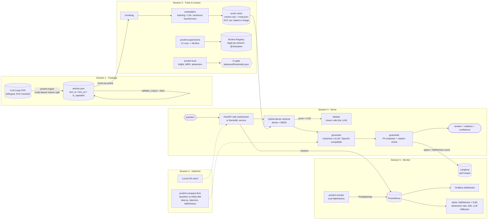

# Architecture

## Why these choices
- **Chunk by article, not by token count.** A legal article is the natural unit of meaning and of citation; every chunk keeps its article number so retrieval can always cite.
- **Abstention is a feature.** Below a calibrated confidence the service refuses instead of guessing, and the LLM is never called.
- **The LLM is optional and replaceable.** Anything that speaks the OpenAI chat-completions protocol (vLLM included) plugs in via three environment variables; if it fails, answers fall back to extractive text and the failure is flagged and counted.
- **Guardrails run on the way out.** A hallucinated `[Article 999]` or a leaked phone number never reaches the user.
- **Everything measurable is exported**: latency, abstentions, retrieval-score distribution, query drift, token cost, guardrail trips, faithfulness.
